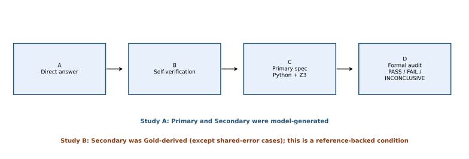
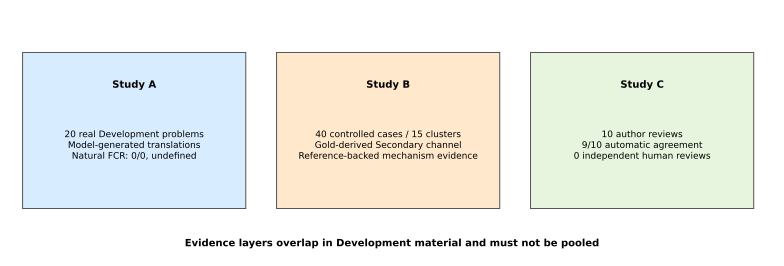
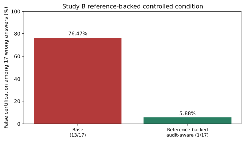
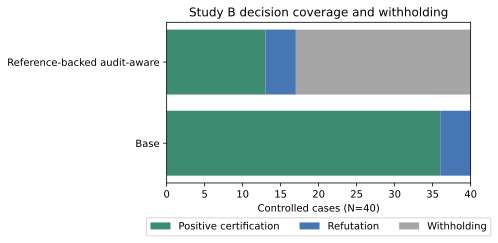
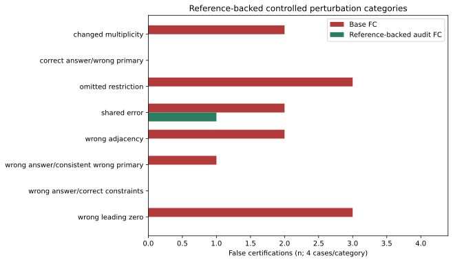
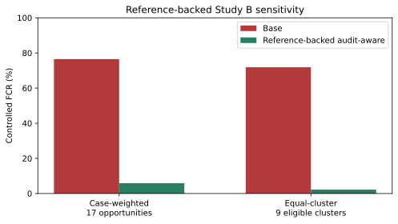
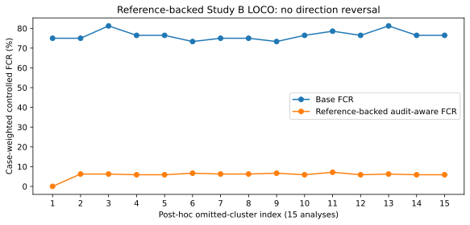

# AXIOM-X: Development-Stage Evidence on False Certification in LLM-Generated Mathematical Constraints

**Public preprint v0.1.0-development — Development-stage, non-confirmatory, exploratory**

**Author:** [@tzlh888](https://github.com/tzlh888) — Independent Researcher

## Abstract

Symbolic solvers can compute exactly with a supplied formal specification, but solver correctness does not establish that the specification faithfully represents a natural-language problem. AXIOM-X studies this boundary in a neuro-symbolic mathematical verification pipeline. It separates direct answering, self-verification, primary constraint translation, executable Python and Z3 checks, and a formal audit that may pass, fail, or withhold judgment. This paper reports three non-poolable Development-stage evidence layers. In Study A, a real DeepSeek pilot produced initial and self-verification answers consistent with project Gold for 20/20 Development problems. No naturally produced answer error occurred, so natural false certification was `0/0` and undefined. Study B evaluated a fixed controlled challenge set of 40 cases derived from 15 base problems. Its Primary specification was a deterministic mutation of the project Gold specification, while its Secondary was the unmodified Gold-derived specification except in shared-error cases. Study B therefore evaluates a **reference-backed controlled audit condition**, not an independently generated secondary LLM translation on natural errors. Among 17 wrong-answer opportunities, case-weighted Base and Audit-Aware false-certification rates were 13/17 (76.47%) and 1/17 (5.88%); equal-cluster-weighted rates were 71.85% and 2.22%. All 15 post-hoc leave-one-cluster-out analyses preserved the direction of the reduction. Exploratory cluster-bootstrap ranges are sensitivity summaries, not population confidence intervals. Audit-aware decision coverage was 17/40, comprising 13 positive certifications and four refutations, while 23/40 cases were withheld. Study C is an author-review and evidence-provenance audit: 9/10 answers matched automatically, and one required a same-author, post-Gold format-only adjudication before the operational total became 10/10; independent human review remained zero. The evidence supports a mechanism-level observation under a Gold-referenced controlled condition, not the deployment effectiveness of an independent LLM audit, natural model error prevalence, independently validated Gold, source-to-specification equivalence, or Held-out generalization.

**Keywords:** neuro-symbolic verification; specification fidelity; false certification; constraint translation; selective prediction; evidence provenance

## 1. Introduction

Large language models (LLMs) can translate natural-language mathematics into programs, logical formulas, or solver constraints. Delegating arithmetic and satisfiability reasoning to deterministic software is attractive because it can remove some calculation errors and make the execution step reproducible. The guarantee is conditional, however. A solver establishes a property of the specification it receives; it does not independently establish that the specification preserves the source problem's meaning. A mistranslation can therefore be executable, internally consistent, and wrong with respect to the original question.

AXIOM-X examines this specification boundary. The pipeline separates four stages: a direct answer (A), model self-verification (B), primary symbolic verification (C), and a secondary translation audit (D). Python enumeration, an optimized procedure, and Z3 evaluate executable constraints. The base verifier relies on the primary formalization. In Study A, the audit-aware policy compared a separately model-generated Secondary formalization and could withhold a decision. Study B used a different construction: its Secondary was normally the unmodified project Gold specification, so its controlled comparison was reference-backed rather than an evaluation of a naturally generated independent LLM audit channel.

The project does not claim that adding a solver makes LLM outputs correct. Its narrower question is whether a secondary translation audit can reduce **false certification**: acceptance of a wrong candidate answer because the executable formalization itself is wrong. This question must be separated from ordinary answer accuracy, solver correctness, and formal-specification executability.

Three studies provide different evidence and use different units of analysis. Study A records unmanipulated outputs from a real DeepSeek Development pilot on 20 problems. Study B is a frozen offline challenge set of 40 controlled cases derived from Development material. Study C is a non-independent author review of a frozen ten-problem subset of Study A. The studies overlap in source material and are not pooled into a larger sample. Study B's constructed cases are not natural model observations, and Study C is not an independent human review.

The contributions supported by the present evidence are:

1. a staged A/B/C/D protocol that separates answer generation, executable verification, and translation audit;
2. an explicit, paired comparison of base and reference-backed audit-aware decision policies on frozen solver-consistent perturbations;
3. separate accounting of false certification, explicit detection, abstention, decision coverage, positive certification, and refutation;
4. a negative common-mode result in which aligned primary and secondary errors survive the audit; and
5. an append-only, hash-bound local evidence workflow with clearly stated threat-model limits.

AXIOM-X does not claim to discover the general specification gap for the first time. Prior work has already distinguished formal correctness from semantic fidelity. The project contribution is a scoped Development-stage empirical protocol and its controlled observations.

## 2. Research Questions and Scoped Claims

The paper addresses five research questions.

- **RQ1 — Mechanism:** Can an executable but semantically wrong formalization cause a base neuro-symbolic verifier to certify an incorrect answer?
- **RQ2 — Reference-backed audit effect:** On the same controlled cases, does an audit supplied with a Gold-derived Secondary reduce false certification relative to the Base policy?
- **RQ3 — Detection versus abstention:** When certification is blocked, how often does the audit explicitly return `FAIL`, and how often does it merely return `INCONCLUSIVE`?
- **RQ4 — Selectivity cost:** What decision-coverage cost accompanies the audit-aware policy?
- **RQ5 — Residual failure:** What happens when the Primary and Secondary specifications share the same semantic error?

The primary supported hypothesis is deliberately narrow:

> On the frozen controlled Development probe, the reference-backed audit-aware policy produces fewer false certifications than the Base policy on the same actually wrong candidate answers.

This hypothesis concerns the fixed controlled sample. It is not a hypothesis about the prevalence of natural LLM errors or about production reliability. A broader claim that AXIOM-X reliably prevents naturally occurring false certification remains **inconclusive** because Study A generated no wrong initial answers, Study C was not independent, and no credible Held-out evaluation has been completed.

## 3. Related Work

### 3.1 Mathematical reasoning and answer verification

Verifier-guided mathematical reasoning can improve candidate selection without resolving every upstream semantic issue. Cobbe et al. (2021) trained verifiers to rank solutions to mathematical word problems. Lewkowycz et al. (2022) demonstrated strong quantitative reasoning through technical pretraining, while Wang et al. (2023) improved reasoning accuracy by aggregating multiple sampled chains of thought. Process-oriented verification evaluates intermediate steps rather than only final answers (Lightman et al., 2023), and deductive verification decomposes reasoning into localized obligations (Ling et al., 2023). These approaches address answer or reasoning reliability, but they do not by themselves show that a generated executable specification is faithful to a source question.

### 3.2 Program-aided and neuro-symbolic reasoning

Program-aided language models delegate generated computations to an external runtime (Gao et al., 2023). Logic-LM, LINC, and SatLM instead translate natural language into symbolic or declarative representations and then invoke external solvers (Pan et al., 2023; Olausson et al., 2023; Ye et al., 2023). This modularization can improve arithmetic and logical execution after translation. It does not eliminate translation risk. Logic-LM distinguishes executability from semantic correctness, LINC reports semantic-parsing failures on more naturalistic inputs, and SatLM scopes correctness to the parsed specification. AXIOM-X studies the downstream consequence of that boundary: an incorrect specification can still support a solver-consistent certification.

### 3.3 Natural language to formal specification

Autoformalization work shows that LLMs can translate some mathematical statements into proof-assistant languages while leaving substantial translation error (Wu et al., 2022). Fine-grained natural-language-to-first-order-logic evaluation exposes weaknesses obscured by aggregate end-to-end scores (Yang et al., 2024). The nl2spec system uses source-fragment mappings and human interaction to repair erroneous or ambiguous temporal-logic translations (Cosler et al., 2023). Gordon and Matskevich (2022) state the core limitation directly: a proof assistant may prove a formal claim that mistranslates its natural-language source. AXIOM-X therefore does not present the specification gap as novel. Its scoped contribution is a paired evaluation of one automated mitigation under frozen controlled perturbations.

### 3.4 SMT solving, selective prediction, and abstention

Z3 decides properties of supplied formulas (de Moura and Bjørner, 2008); it does not validate the natural-language provenance of those formulas. The AXIOM-X audit-aware policy is also a selective decision system. Selective classification evaluates error jointly with coverage (Geifman and El-Yaniv, 2017), and SelectiveNet integrates rejection into model optimization (Geifman and El-Yaniv, 2019). LLM self-evaluation has similarly been used as a selective-generation signal (Ren et al., 2023). In AXIOM-X, withholding a decision can improve safety but is not equivalent to locating an error. The paper therefore reports `FAIL` separately from `INCONCLUSIVE`.

### 3.5 Scope of the literature review

The project literature register contains 17 entries checked against conference, publisher, ACL Anthology, PMLR, OpenReview, or arXiv pages. The review was a targeted scoping review, not a systematic review. It does not justify priority claims. Human bibliographic checking, reproducible search criteria, and forward/backward citation tracing remain necessary before submission.

## 4. AXIOM-X Architecture

AXIOM-X links four records for each real model problem:

1. **A — Direct answer.** The model proposes a numerical answer from the natural-language problem.
2. **B — Self-verification.** The model recomputes or checks that answer under a frozen prompt.
3. **C — Primary symbolic verification.** A primary translator produces structured constraints. Brute-force Python, an optimized implementation, and Z3 evaluate the candidate relative to that representation.
4. **D — Formal audit.** The Primary and Secondary representations are compared with each other and with conditions recognized from source text. In Study A the Secondary was model-generated; in Study B it was Gold-derived except in shared-error cases. The audit returns `PASS`, `FAIL`, or `INCONCLUSIVE`.

The base policy produces a verified or refuted decision from the primary representation and executable results. The audit-aware policy makes a decision only when the audit permits it. A `PASS` allows the base outcome to remain either a positive certification or a refutation. A `FAIL` or `INCONCLUSIVE` withholds the audit-aware decision. This distinction is essential: audit `PASS` is not identical to positive certification, because a passed audit can accompany a correct refutation of a wrong answer.



**Figure 1. AXIOM-X decision architecture and study-specific Secondary provenance.** The solver establishes properties of the Primary specification. Study A used a model-generated Secondary; Study B directly supplied a Gold-derived Secondary except in shared-error cases.

In Study A, the Primary and Secondary translations were separately model-generated but not statistically or causally independent; they shared a provider and could share training data and inductive biases. Study B did not generate either representation with an LLM during the probe. Its Gold-derived Secondary supplied reference information directly to the audit. Agreement in either study is not proof of source fidelity, and Study B performance cannot be attributed to an independent LLM translation channel.

## 5. Evidence Model and Provenance

### 5.1 Three evidence layers

**Table 1. Evidence registry. Counts are study-specific and must not be pooled.**

| Evidence layer | Unit | Size | Source and purpose | Principal supported statement | Principal unsupported statement |
|---|---|---:|---|---|---|
| Study A: real Development pilot | Development problem | 20 | Unmanipulated DeepSeek outputs; engineering feasibility | The frozen pipeline completed and all recorded answers matched project Gold on these 20 problems | Natural FCR, population accuracy, or Held-out generalization |
| Study B: reference-backed controlled error probe | Controlled case clustered within base problem | 40 cases / 15 clusters | Gold-derived Secondary; eight controls plus 32 designed perturbations | Base and reference-backed audit-aware policies can be compared on fixed constructed mechanisms; post-hoc cluster sensitivity can be described | Independent LLM-audit effectiveness, natural error prevalence, confirmatory population inference, or deployment risk |
| Study C: author review and evidence-provenance audit | Development problem, subset of Study A | 10 | Author-to-Gold comparison, disclosure gates, and post-Gold adjudication | Nine automatic normalized agreements, one author format adjudication, and traceable local process state | Independent human Gold validation or LLM accuracy |
| Future Held-out evaluation | Held-out problem | 0 completed credibly | Currently blocked | No positive generalization claim | Any statement of Held-out success |



**Figure 2. Non-poolable evidence layers.** Study A, Study B, and Study C use different units and answer different questions.

Study C's ten problems are a subset of Study A's 20 problems. Study B cases are controlled experimental units, often derived from shared base problems. Adding 20, 40, and 10 would therefore be scientifically meaningless.

### 5.2 Three levels of validity

The evidence model distinguishes program integrity, mathematical correctness relative to supplied artifacts, and scientific validity. These levels are summarized with their limits in Table 7 after the three study-specific result tables. Passing a lower-level integrity check does not imply a higher-level validity claim.

### 5.3 Provenance boundaries

Study A and Study B were consolidated from approved derived reports and frozen public identities. The Study B post-hoc cluster report has SHA-256 `64dbd8698644410cd59ca384cd7ae2353fdd0ef0becea9150aba829601dd0074`; it parses the already-public 40-case table and does not add or alter experimental observations. The V2.1 author-review report is a public, counts-only derivative with SHA-256 `9246c2bf0d70706e871485b2106731a08908cb0174c44465d303b6267694f887`. Its private evidence-freeze manifest is identified by operator-reported SHA-256 `420c105a9855b1885557e9f2460e80660a8ac739069dc8e37c36b168b02a0fb9`. The public evidence source is the operator-reported counts-only derivative; neither that source report nor the present public release independently opened or reverified the private manifest or private ledgers. Accordingly, statements about that freeze are attributed to the operator-reported result rather than presented as a second independent audit.

## 6. Methods

### 6.1 Study A: real DeepSeek Development pilot

Study A comprised 20 Development problems: ten digit-constraint problems and ten bounded-integer problems. The recorded difficulty distribution was eight easy, eleven medium, and one hard. The model alias was `deepseek-flash`, with low reasoning effort, a 1,024-token output cap, frozen prompts, and four A/B/C/D provider calls per problem.

All 20 problems produced complete linked A/B/C/D records. Eighty completed provider events were linked to those records, and no Mock record was counted as a real observation. For each problem, brute-force Python, optimized Python, and Z3 produced a result consistent with the recorded project Gold, giving 60/60 executor-to-Gold agreements. The source records retained `source_equivalence_established=false`; executor agreement therefore does not constitute independent semantic validation.

Across the broader Development execution history, 82 attempts comprised 80 completed requests and two failed requests with unknown provider usage. Local protocol accounting totaled USD 0.064574: USD 0.044574 in usage-based estimates and USD 0.02 in conservative reservations. This is not a supplier invoice and is not used as a scientific outcome.

### 6.2 Study B: frozen controlled error probe

Study B froze 40 cases before formal execution: eight unperturbed correct controls and 32 perturbation cases. Eight predefined categories contributed four cases each: wrong answer with correct constraints; correct answer with wrong primary constraints; wrong answer consistent with wrong primary constraints; omitted source restriction; changed element multiplicity; incorrect leading-zero handling; incorrect adjacency handling; and shared primary/secondary error. The frozen mix contained 26 digit cases and 14 bounded-integer cases. Previously previewed V1 fixtures and three previously used base problems were excluded.

The term *perturbation case* does not imply that the candidate answer became wrong. Of the 32 perturbations, 17 produced an actually wrong candidate answer relative to the project Gold; 15 preserved the recorded answer. Together with the eight controls, 23 of 40 cases had actually correct candidate answers. The 17 wrong-answer cases form the false-certification denominator. The 23 correct-answer cases form the frozen denominator for Base false refutation.

The same controlled case was evaluated by the Base and reference-backed audit-aware policies. This paired design isolates a decision-rule difference while controlling the reference specification, but it is not a random sample of natural LLM failures and does not isolate the effectiveness of an independently generated LLM Secondary. The 40 cases were derived from 15 base problems; cluster sizes ranged from one to six. Only nine base-problem clusters contained at least one wrong-answer opportunity. Case-level observations are therefore neither independent nor equally distributed across base problems.

#### 6.2.1 Formal inputs and controlled Primary/Secondary relationship

The executable specification is a strict tagged union of two finite families. A digit-permutation specification records digit multiplicities, whether a leading zero is allowed, adjacency or non-adjacency constraints, and whole-number modular constraints. A bounded-integer specification records named variables with inclusive finite bounds, linear equations, parity constraints, and linear modular constraints. Unknown fields and coercive schema conversions are rejected.

Study B made no LLM translation calls. It began from the frozen project Gold specification and applied a deterministic, preregistered mutation to construct the controlled Primary. For every non-shared-error case, the Secondary passed into `audit(source, Primary, Secondary)` was the **unmodified Gold-derived specification**. In the shared-error category, the same mutated specification was assigned to both Primary and Secondary. The audit therefore received reference-specification support directly; this is a Gold-referenced, oracle-assisted controlled condition, not a natural independent-translation condition.

This construction is useful for mechanism isolation: it holds a reference representation fixed while varying known Primary fields and can attribute failures to predefined perturbations. It also creates reference leakage and label endogeneity. The Gold specification supplies the usual Secondary, defines structural translation-correctness labels, seeds Primary mutations, and—together with the project Gold answer—helps define answer correctness and FC denominators. The experiment cannot separate the audit rule from this reference assistance or estimate how a second LLM would behave on natural errors.

The source-condition checker is partially separate: it extracts expected features from the natural-language source with implemented regular expressions rather than accepting Gold as an explicit expected-condition argument. However, it checks only recognized patterns and evaluates the Gold-derived Secondary as one of its inputs. It is therefore not an independent source-to-specification semantic oracle. Neither the reference labels nor the checker independently prove that the project Gold specification is faithful to the source text.

#### 6.2.2 Base verification and formal audit

For each Primary specification, brute-force Python, optimized Python, and Z3 had to establish the same exact finite solution count. Any schema failure, resource failure, or solver disagreement stopped formal execution rather than silently producing a decision. Given agreed count \(c_P\) and candidate answer \(a\), the Study B Base decision was `Verified` when \(a=c_P\) and `Refuted` otherwise.

The audit applied two implemented checks. First, a pattern-based checker extracted supported conditions from the source text and compared them with each formalization. For digit cases, implemented patterns covered digit multiset and length, use-all-digits semantics, leading-zero restrictions, selected adjacency expressions, and modular conditions. For bounded-integer cases, they covered selected bounds, nonnegativity phrasing, one recognized linear-equation form, parity, and supported modular expressions. The checker explicitly marks strict inequalities and the absence of any recognized condition as incomplete, but it cannot enumerate every unsupported natural-language condition; a missed pattern can therefore remain invisible. Second, a comparator canonicalized both specifications. Equal canonical fingerprints established specification-relative equivalence; otherwise, the code compared complete finite solution **sets** under resource limits. Equal solution counts alone never established equivalence.

Audit status followed the implemented rules:

- `FAIL` if either formalization conflicted with an explicitly recognized source condition.
- `PASS` only if the specifications were equivalent under canonical or complete finite-solution-set comparison and both implemented source checks returned `CONSISTENT`. `PASS` means that these rules found no conflict; it is not a proof of natural-language equivalence or Gold correctness.
- `INCONCLUSIVE` if a translation was unavailable, finite comparison exceeded limits, implemented source coverage was incomplete, or solution sets differed but the audit could not identify which formalization was faithful.

The audit-aware policy preserved the Base result only after `PASS`: Base `Verified` became `Audit-Qualified Verified`, and Base `Refuted` became `Audit-Qualified Refuted`. `FAIL` and `INCONCLUSIVE` both yielded `Unknown`; only the former counted as explicit error detection.

#### 6.2.3 Executable decision flow

```text
for each frozen controlled case:
    GoldSpec  := frozen project Gold specification
    Primary   := deterministic_mutation(GoldSpec)
                 # identity/no-op mutation is permitted for unperturbed
                 # controls and other cases whose Primary is unchanged
    Secondary := GoldSpec                 # direct reference support
    if category == shared_primary_secondary_error:
        Secondary := Primary              # same mutated error in both channels

    counts := [brute_force(Primary), optimized(Primary), z3(Primary)]
    require all three methods to establish the same exact count c_P
    Base := Verified if candidate_answer == c_P else Refuted

    PrimaryCoverage   := regex_conditions_from_source(source, Primary)
    SecondaryCoverage := regex_conditions_from_source(source, Secondary)
    Comparison        := canonical equality or complete finite solution-set comparison

    if either Coverage is Discrepancy:
        Audit := FAIL
    else if Comparison is Equivalent
            and both implemented Coverage checks are Consistent:
        Audit := PASS                       # no implemented conflict found
    else:
        Audit := INCONCLUSIVE

    Final := qualified(Base) if Audit == PASS else Unknown
```

This audit is deliberately incomplete. Its source checker recognizes only implemented patterns; equivalent erroneous specifications can pass; and project-Gold-relative mutation labels are not independent semantic judgments. In Study B, moreover, Primary and Secondary were controlled artifacts rather than translator outputs, and the Gold-derived Secondary acts as reference assistance. Shared mutation shows that even this condition can miss a common-mode error. `source_equivalence_established` therefore remains false.

### 6.3 Study C: author review and evidence-provenance audit

Study C selected and froze ten Development problems from Study A's 20-problem set. Its primary role in this paper is to document author-review workflow and evidence provenance, not to estimate model accuracy or independently validate Gold. The project author completed, sealed, and disclosed ten review records before Gold comparison. A cohort gate required all ten sealed submissions and all ten disclosure confirmations before the cohort-only Gold package could be compared. The review role remained `AUTHOR_REVIEW`; no record was classified as `INDEPENDENT_HUMAN_REVIEW`.

The frozen automatic comparison classified nine records as `MATCHED`, one as `MANUAL_COMPARISON_REQUIRED`, and none as `DISPUTED`. The unresolved record was later viewed by the same author together with Gold and adjudicated as `FORMAT_ONLY_MATCH`. The adjudication appended a new event without replacing the original comparison. It is reported separately because Gold was visible and the adjudicator was the original author.

### 6.4 Metric definitions

Let \(N\) denote the number of cases in the relevant study and let \(W\) be the subset whose candidate answers are actually wrong relative to project Gold.

- **False Certification (FC):** a wrong candidate answer is positively certified by the evaluated policy.
- **False Certification Rate:**
  \[
  \mathrm{FCR}=\frac{\#\{i\in W:\text{policy positively certifies }i\}}{|W|}.
  \]
  If \(|W|=0\), FCR is **undefined**, not zero.
- **Decision Coverage:**
  \[
  \mathrm{Coverage}=\frac{\#\text{positive certifications}+\#\text{refutations}}{N}.
  \]
  A withheld or unknown outcome is not covered. Coverage is not synonymous with positive certification.
- **Positive Certification Rate:** positive certifications divided by \(N\).
- **Refutation Rate:** refutations divided by \(N\).
- **Withholding/Unknown Rate:** cases without an audit-aware certification or refutation divided by \(N\).
- **False Refutation:** an actually correct candidate answer refuted by the evaluated policy. The frozen `2/23` Study B endpoint is explicitly the **Base False Refutation Rate**.
- **Audit FAIL Detection Rate:** explicit audit `FAIL` outcomes divided by the frozen set of 28 audit-eligible translation-perturbation cases. It is not a natural-error detection rate.
- **INCONCLUSIVE Abstention Rate:** audit `INCONCLUSIVE` outcomes divided by all 40 controlled cases.
- **Original Automatic Agreement:** Study C records classified as `MATCHED` by frozen normalization, divided by ten.
- **Post-Gold Author-Adjudicated Agreement:** original automatic matches plus records adjudicated as matches after Gold was revealed to the author, divided by ten. This measure is dependent and non-blind.

### 6.5 Statistical analysis

Study A and Study B case-level binomial proportions retain Wilson 95% intervals where previously reported, but these intervals are mechanical descriptive calculations. They are not confidence intervals for natural model accuracy or a naturally sampled task population.

Study B reports two post-hoc estimands. The case-weighted estimand gives every controlled case equal weight. The equal-cluster-weighted estimand first computes the relevant proportion within each base-problem cluster and then averages clusters equally. For FCR, only the nine clusters with at least one wrong-answer opportunity contribute; decision outcomes use all 15 clusters. LOCO sensitivity deletes each complete cluster in turn. An exploratory cluster bootstrap resamples the 15 clusters with replacement 100,000 times using seed `20261021`, retaining every case inside each selected cluster. Its empirical percentile ranges characterize sensitivity to these observed clusters; they are not confirmatory population confidence intervals.

The preregistered case-level exact McNemar calculation used 12 Base-only FCs and zero Audit-only FCs. Because cases share base problems and were constructed rather than independently sampled, its `p` value is not used as formal independent-sample inference in the main Results. It is retained only in Appendix E as an execution-record descriptor.

Study C proportions are descriptive cohort summaries. No confidence interval is used to imply sampling-based generalization from the author-selected Development cohort. No cross-study statistic pools Study A, Study B, and Study C.

### 6.6 Integrity controls

Study B used a frozen sample plan, configuration and code identities, a one-shot authorization, an append-only hash-chained ledger, a persistent execution marker, a terminal completion record, a terminal seal, and result recomputation. The formal review reported one header, 40 unique cases, one final completion event, and a valid seal bound to the frozen case set and statistics.

Study C used append-only submission, disclosure, comparison, and adjudication events, followed by an evidence freeze. The operator reported `FROZEN` and `PASS`, with byte-identical primary and backup manifests. These mechanisms support local consistency checks. They do not prove mathematical truth, provide an external trusted timestamp, establish non-repudiation, or prevent coordinated rewriting by an actor with unrestricted write access to all local evidence and anchors.

## 7. Results

### 7.1 Study A: real Development observations

**Table 2. Real DeepSeek Development pilot. The unit is a Development problem except for translator-output and executor rows.**

| Outcome | Numerator/denominator | Estimate | Wilson 95% CI | Interpretation |
|---|---:|---:|---:|---|
| Initial answer agreement with project Gold | 20/20 | 100% | 83.89–100% | No observed initial answer error in this Development set |
| Self-verification agreement with project Gold | 20/20 | 100% | 83.89–100% | No correction opportunity and no introduced error |
| Primary translation vs. Gold normalization | 20/20 | 100% | 83.89–100% | Internal project consistency, not independent semantic review |
| Secondary translation vs. Gold normalization | 20/20 | 100% | 83.89–100% | Separately generated but correlated with Primary |
| Combined translator outputs | 40/40 | 100% | 91.24–100% | Forty correlated outputs, not 40 independent problems |
| Base decision coverage | 20/20 | 100% | 83.89–100% | All 20 received a base decision |
| Audit-aware decision coverage | 20/20 | 100% | 83.89–100% | No withholding on these observations |
| Natural false-certification rate | 0/0 | Undefined | Undefined | No wrong initial answer existed |
| Natural audit error-detection rate | 0/0 | Undefined | Undefined | No natural error existed to detect |

Study A establishes that the end-to-end API, translation, solver, and audit workflow completed on the 20 recorded Development problems. It does not show that the audit prevents naturally occurring errors. The absence of wrong answers removes the opportunity denominator for both FCR and natural error-detection rate.

### 7.2 Study B: controlled error probe

Study B results below are conditional on a Gold-derived Secondary and must not be interpreted as the effectiveness of an independently generated Secondary LLM translation on natural errors.

**Table 3. Case-weighted reference-backed controlled-probe results. The unit is one frozen controlled case. Wilson intervals are mechanical descriptive references for this fixed challenge set, not natural-population confidence intervals.**

| Outcome | Numerator/denominator | Estimate | Descriptive Wilson 95% interval | Scope |
|---|---:|---:|---:|---|
| Base false certification | 13/17 wrong answers | 76.47% | 52.74–90.44% | Controlled wrong-answer cases |
| Audit-aware false certification | 1/17 wrong answers | 5.88% | 1.05–26.98% | Same paired cases |
| Base decision coverage | 40/40 cases | 100% | 91.24–100% | Base certification or refutation |
| Audit-aware decision coverage | 17/40 cases | 42.50% | 28.51–57.80% | 13 certifications plus 4 refutations |
| Audit-aware positive certification | 13/40 cases | 32.50% | Not a preregistered interval | Positive certification only |
| Audit-aware refutation | 4/40 cases | 10.00% | Not a preregistered interval | Refutation only |
| Audit-aware withheld/unknown | 23/40 cases | 57.50% | Not a preregistered interval | `FAIL` or `INCONCLUSIVE` blocks a decision |
| Audit `FAIL` detection | 20/28 eligible perturbations | 71.43% | 52.94–84.75% | Explicit inconsistency finding |
| Audit `INCONCLUSIVE` abstention | 3/40 cases | 7.50% | 2.58–19.86% | Withheld without localized error |
| Base false refutation | 2/23 correct answers | 8.70% | 2.42–26.80% | Base policy only |
| Correct-control rejection | 0/8 controls | 0% | 0–32.44% | Unperturbed controls only |
| Shared-error miss | 2/4 shared-error cases | 50% | 15.00–85.00% | Constructed common-mode challenges |



**Figure 3. False certification under the Study B reference-backed condition.** Percentages condition on 17 constructed wrong-answer opportunities; they are neither natural error rates nor estimates for an independent LLM Secondary.



**Figure 4. Reference-backed audit-aware coverage trade-off.** Coverage was 17/40: 13 positive certifications plus four refutations; 23 decisions were withheld.

The paired FC table contained one case falsely certified by both policies, 12 Base-only false certifications, zero Audit-only false certifications, and four cases falsely certified by neither policy. Within the frozen reference-backed probe, the audit-aware policy blocked 12 of 13 Base FCs: ten through explicit `FAIL` and two through `INCONCLUSIVE`. One FC survived. The case-level McNemar calculation is relegated to Appendix E because the 17 cases are clustered within base problems and do not constitute 17 independent sampled units.

The reduction in FC was accompanied by a 57.5 percentage-point drop in decision coverage, from 40/40 to 17/40. The 17 covered audit-aware cases should not be misreported as 17 positive certifications: they comprised 13 certifications and four refutations. Conversely, the 23 withheld cases were not all explicit error detections; three were inconclusive abstentions.

**Table 4. Reference-backed controlled categories. Manipulation success (wrong-answer yield) is the number of cases whose candidate answer actually differed from project Gold, not a natural error frequency. `P/F/I` denotes Audit PASS/FAIL/INCONCLUSIVE; coverage counts `AQV` plus `AQR`.**

| Controlled category | n | Manipulation success (wrong-answer yield) | Base FC | Audit FC | Audit P/F/I | Decision coverage |
|---|---:|---:|---:|---:|---:|---:|
| Wrong answer + correct constraints | 4 | 4/4 | 0 | 0 | 4/0/0 | 4/4 |
| Correct answer + wrong Primary | 4 | 0/4 | 0 | 0 | 1/2/1 | 1/4 |
| Wrong answer + consistent wrong Primary | 4 | 1/4 | 1 | 0 | 1/2/1 | 1/4 |
| Omitted source restriction | 4 | 3/4 | 3 | 0 | 0/4/0 | 0/4 |
| Changed digit multiplicity | 4 | 2/4 | 2 | 0 | 1/3/0 | 1/4 |
| Incorrect leading-zero rule | 4 | 3/4 | 3 | 0 | 0/3/1 | 0/4 |
| Incorrect adjacency rule | 4 | 2/4 | 2 | 0 | 0/4/0 | 0/4 |
| Shared Primary/Secondary error | 4 | 2/4 | 2 | 1 | 2/2/0 | 2/4 |
| **Perturbation total** | **32** | **17/32** | **13** | **1** | **9/20/3** | **9/32** |
| Unperturbed controls | 8 | Not applicable | 0 | 0 | 8/0/0 | 8/8 |
| **All cases** | **40** | **17 wrong answers** | **13** | **1** | **17/20/3** | **17/40** |



**Figure 5. False certifications by reference-backed controlled perturbation category.** Each perturbation category contains four cases; control cases are omitted from this plot.

The `17/32` manipulation success (wrong-answer yield) means that 17 of the 32 predefined perturbations changed the candidate numerical answer relative to project Gold. The other 15 perturbations remained in the frozen experiment but did not create an FC opportunity. It is neither an estimate of natural LLM error prevalence nor a manipulation-exclusion rule.

**Table 5. Post-hoc cluster-aware sensitivity for the reference-backed Study B condition. FCR cluster weighting uses the nine base-problem clusters containing at least one wrong-answer opportunity; decision metrics use all 15 clusters.**

| Metric | Case-weighted | Equal-cluster-weighted | LOCO range | Exploratory cluster-bootstrap 2.5%–97.5% |
|---|---:|---:|---:|---:|
| Base FCR | 76.47% | 71.85% | 73.33–81.25% case-weighted; 68.33–80.83% cluster-weighted | 54.55–92.31% case-weighted; 42.67–96.30% cluster-weighted |
| Audit-Aware FCR | 5.88% | 2.22% | 0–7.14% case-weighted; 0–2.50% cluster-weighted | 0–13.33% case-weighted; 0–7.27% cluster-weighted |
| FCR absolute reduction | 70.59 pp | 69.63 pp | 66.67–75.00 pp case-weighted; 65.83–78.33 pp cluster-weighted | 50.00–90.91 pp case-weighted; 40.74–94.44 pp cluster-weighted |
| Audit decision coverage | 42.50% | 45.00% | 41.03–44.44% case-weighted; 41.07–48.21% cluster-weighted | 35.29–50.00% case-weighted; 31.67–58.89% cluster-weighted |
| Positive certification | 32.50% | 32.22% | Not primary LOCO endpoint | 23.40–42.42% case-weighted; 19.44–46.11% cluster-weighted |
| Refutation | 10.00% | 12.78% | Not primary LOCO endpoint | 2.50–19.44% case-weighted; 1.67–28.33% cluster-weighted |
| Withholding | 57.50% | 55.00% | Complement of LOCO coverage | 50.00–64.71% case-weighted; 41.11–68.33% cluster-weighted |



**Figure 6. Case- and equal-cluster-weighted FCR under the reference-backed controlled condition.** Equal-cluster FCR averages the nine clusters containing wrong-answer opportunities.



**Figure 7. Post-hoc leave-one-cluster-out sensitivity for the reference-backed controlled condition.** Cluster labels are replaced by index; all deletions retained Base FCR > Audit-aware FCR.

All 15 LOCO analyses preserved the direction Base FCR > Audit-Aware FCR. The largest cluster contained 6/40 cases, 5/17 wrong answers, and 4/13 Base FCs. Removing it left case-weighted Base/Audit FCR at 75.00%/0.00%. Base FC nevertheless concentrated: four clusters contributed 10/13 events, while the only Audit FC occurred in one shared-error cluster. The direction is not explained by one base problem, but the magnitude and residual-risk frequency remain imprecise.

The bootstrap resampled 15 observed base-problem clusters 100,000 times with replacement and retained every case within a sampled cluster. Its wide empirical percentile ranges are exploratory sensitivity summaries. They do not supply confirmatory confidence intervals because the 15 Development clusters were not randomly sampled from a defined task population.

### 7.3 Study C: Author Review and Evidence-Provenance Audit

**Table 6. V2.1 author review and provenance audit. The unit is a frozen Development problem, and all ten overlap Study A.**

| Stage and outcome | Numerator/denominator | Descriptive result | Interpretation |
|---|---:|---:|---|
| Author submissions sealed | 10/10 | 100% process completion | Does not imply correctness |
| Disclosure confirmations | 10/10 | 100% process completion | Structured disclosure gate completed |
| Original automatic `MATCHED` | 9/10 | 90% | Agreement under frozen normalization |
| Original `MANUAL_COMPARISON_REQUIRED` | 1/10 | 10% | Automatic normalization did not decide |
| Original `DISPUTED` | 0/10 | 0% | No automatic record classified as disputed |
| Post-Gold author `FORMAT_ONLY_MATCH` | 1/1 unresolved | 100% of unresolved records | Same author adjudicated after seeing Gold |
| Post-adjudication matched | 10/10 | 100% | Nine automatic plus one dependent post-Gold adjudication |
| Post-adjudication unresolved | 0/10 | 0% | Operational resolution, not independent validation |
| Independent human review | 0 records | None | No independent blind Gold evidence |

The original 9/10 automatic agreement and the post-adjudication 10/10 agreement answer different questions and must remain separate. The latter includes a Gold-revealed decision by the original author and therefore cannot replace the former or be treated as an independent verification result.

### 7.4 Evidence levels and validation scope

**Table 7. Evidence levels and validation scope.**

| Level | What the current evidence can establish | What it cannot establish |
|---|---|---|
| Program integrity | Recorded files, hash chains, configuration identities, case counts, and frozen summaries are internally consistent within the local threat model | Mathematical truth, semantic fidelity, external timestamping, or resistance to an actor who can rewrite every local anchor |
| Mathematical correctness relative to supplied artifacts | Solvers agree on calculations under a formal specification; answers can agree with supplied Gold under frozen normalization | That Gold is independently correct or that the formal specification faithfully represents the source text |
| Scientific validity and generalization | Controlled mechanisms can be demonstrated on fixed Development cases | Natural error prevalence, general model reliability, causal independence of translators, or Held-out performance |

### 7.5 Cross-study synthesis

**Table 8. Supported, unsupported, and pending claims.**

| Claim | Status | Evidence and boundary |
|---|---|---|
| An incorrect executable specification can support false certification | Supported in the controlled probe | Base FC occurred in 13/17 actually wrong controlled cases |
| The secondary audit reduced FC on the same frozen controlled cases | Supported descriptively within Study B | Case-weighted FCR was 13/17 versus 1/17; equal-cluster rates were 71.85% versus 2.22%; all 15 post-hoc LOCO analyses retained the direction |
| The audit universally diagnoses translation errors | Not supported | Two blocked FCs were inconclusive; one common-mode FC survived |
| The real Development pipeline executed successfully | Supported for Study A | Complete A/B/C/D records for 20 problems |
| Natural FCR is zero | Unsupported | Study A denominator was 0; FCR is undefined |
| Project Gold has independent human validation | Unsupported | Study C reviewer was the project author; independent count is zero |
| Author answers agreed with Gold | Supported only as scoped | 9/10 automatic; 10/10 only after one post-Gold author adjudication |
| Natural-language/formal-specification equivalence is established | Unsupported | Solver agreement is specification-relative; `source_equivalence_established=false` remains relevant |
| AXIOM-X generalizes to Held-out data | Unsupported | No credible Held-out result; contamination remains `HIGH_UNRESOLVED` |
| Local evidence artifacts are internally consistent | Supported within stated local checks | Hashing, ledgers, seals, and freeze results do not confer external trust or mathematical truth |
| Broad AXIOM-X reliability | Inconclusive | Natural errors, independent Gold review, and clean Held-out evidence are missing |

## 8. Failure Modes and Case Mechanisms

### 8.1 Wrong answer with correct constraints

When the candidate answer was changed but the executable constraints remained correct, the base solver rejected all four wrong candidates. This category demonstrates ordinary solver rejection. It does not test whether the translation audit can discover a wrong formalization and must not be counted as evidence of audit value.

### 8.2 Solver-consistent wrong constraints

Several perturbation categories deliberately aligned a wrong candidate answer with a wrong primary specification. The base verifier then certified the answer because it was correct relative to the supplied model. Omitted restrictions, altered multiplicities, and incorrect leading-zero or adjacency rules generated the core false-certification opportunities. Explicit secondary disagreement blocked most of these cases.

### 8.3 Explicit failure versus inconclusive withholding

Ten base FCs became audit `FAIL`. These cases provide evidence that the audit localized an inconsistency under its frozen rules. Two other base FCs became `INCONCLUSIVE`. Those outcomes were safety-protective because certification was withheld, but they did not identify which translation was faithful. Combining the two categories would overstate diagnostic performance.

### 8.4 Common-mode translation failure

The only surviving audit-aware FC occurred in the shared-error category, where primary and secondary representations adopted the same wrong interpretation. Specification agreement therefore amplified confidence without restoring semantic truth. This negative result shows that the implemented audit can fail even with a Gold-derived reference channel when the same mutation reaches both inputs; it does not test whether prompt diversity among independent translators would help.

### 8.5 False refutation and controls

The base policy falsely refuted two of 23 actually correct candidate answers because the primary formalization was wrong. Under the audit-aware workflow those cases were withheld rather than preserved as positive decisions. All eight unperturbed controls received covered, correct outcomes, but the small control denominator leaves substantial uncertainty and cannot bound production false rejection precisely.

## 9. Discussion

### 9.1 Answers to the research questions

**RQ1:** Yes, the controlled probe demonstrates the mechanism. Thirteen of 17 actually wrong answers were accepted by the base policy when evaluated against the supplied controlled representations.

**RQ2:** Under the Gold-derived Secondary condition, the audit-aware policy reduced case-weighted FC on the paired frozen cases from 13/17 (76.47%) to 1/17 (5.88%). Post-hoc equal-cluster weighting gave 71.85% and 2.22%, respectively, across the nine base-problem clusters that contained wrong-answer opportunities. All 15 LOCO analyses preserved the direction of the difference. This supports the narrow reference-backed controlled hypothesis on the fixed challenge set. It does not establish that an independently generated secondary LLM translation reduces natural false certification.

**RQ3:** Ten prevented FCs were explicit `FAIL` detections; two were `INCONCLUSIVE` abstentions. Prevention was therefore stronger than diagnostic localization.

**RQ4:** Case-weighted decision coverage fell from 40/40 to 17/40 (42.50%). Equal-cluster-weighted audit coverage was 45.00% across all 15 base problems. Audit-aware positive certification was 13/40, refutation was 4/40, and withholding was 23/40. Whether this tradeoff is acceptable depends on error prevalence, review cost, and application risk, none of which is estimated here.

**RQ5:** Shared primary/secondary error remains a direct failure mode. One such case survived as an audit-aware FC. The shared-error miss endpoint `2/4` counts failures to flag the deliberately shared translation error across all four category cases; the audit-aware FC `1/17` counts actually wrong answers that were positively certified across all wrong-answer opportunities. These endpoints have different events and denominators.

### 9.2 Relationship among the studies

Study A supports engineering feasibility and records unmanipulated model behavior on a small Development set. It provides no naturally wrong answer on which to measure false certification. Study B supplies Gold-referenced controlled opportunities for mechanism testing but neither estimates how often they occur naturally nor evaluates a deployment-like independent Secondary translator. Study C checks author-to-Gold agreement on half of Study A's problems, but it is non-independent and partly includes post-Gold adjudication. The studies are complementary only when their scopes remain separate.

### 9.3 Program integrity is not scientific validity

The evidence workflow is stronger than a simple collection of mutable output files: configurations, code identities, event sequences, and summaries are bound through hashes and append-only records. That engineering achievement matters for reproducibility. It cannot convert an internally defined label into an independently validated mathematical truth, nor can it make a Development challenge set representative of deployment. Program integrity, mathematical agreement, and external scientific validity are distinct claims.

### 9.4 Interpretation of the author review

Study C adds traceable author-review evidence but does not close the Gold-validity gap. The 9/10 automatic result reflects a frozen normalization procedure. The tenth record required Gold-revealed judgment by the same author. Even if the adjudication is substantively reasonable, it is vulnerable to confirmation bias and adds no independent reviewer. The correct scientific use of Study C is to document internal consistency and workflow provenance, not to certify the dataset.

### 9.5 Overall hypothesis status

The reference-backed controlled hypothesis is **supported descriptively within Study B**. The similar case- and equal-cluster-weighted estimates and absence of a LOCO direction reversal make the observed mechanism less attributable to one base problem, but the analysis is post hoc and the 15 clusters were not sampled from a target population. The broad reliability hypothesis remains **inconclusive**. Evidence is insufficient for a claim that AXIOM-X prevents natural false certification, that its translators are semantically independent, or that its results generalize beyond the Development materials.

## 10. Threats to Validity

**Development reuse and overlap.** All three studies use Development material, and Study C is a subset of Study A. Study B includes multiple controlled cases derived from shared base problems. Iterative engineering exposure and overlapping units prevent independent-test interpretation.

**Small and constructed samples.** Study A has 20 problems, Study C has ten overlapping problems, and Study B has 40 designed cases. The balanced perturbation categories are experimental choices, not estimates of natural error frequencies.

**Clustered statistical units.** The 40 Study B cases share 15 base problems, only nine of which contain wrong-answer opportunities. Post-hoc equal-cluster weighting and LOCO preserve the direction of the observed FCR reduction, but they do not turn the Development clusters into a random sample. The cluster-bootstrap percentile ranges describe resampling sensitivity among these observed clusters and are not confirmatory population intervals. Wilson intervals and the case-level McNemar result likewise do not remove dependency. Confirmatory work requires a preregistered cluster-level estimand and more independent base problems.

**Gold validity.** Project Gold has not received independent blind human validation. Study C was performed by the project author, and one outcome was adjudicated after Gold was visible. A wrong or ambiguous Gold item could align multiple system components around the same error.

**Reference leakage, oracle assistance, and label endogeneity.** Study B supplied the unmodified Gold-derived specification directly as Secondary in all non-shared-error cases. The same Gold artifacts seeded Primary mutations, defined reference translation labels, and helped define answer-correctness outcomes. This strengthens experimental control but makes audit performance conditional on reference access. It cannot be attributed to an independent LLM translator, and errors in project Gold can propagate into both treatment inputs and labels.

**Semantic equivalence.** Python and Z3 can verify calculations under supplied constraints, but they do not prove that those constraints preserve natural-language meaning. The current project has no independent source-to-specification equivalence proof.

**Secondary-channel validity.** Study A's model-generated Primary and Secondary shared a provider and could share model-level biases. Study B used no LLM translator during the probe: the Secondary was Gold-derived except in shared-error cases. Its result therefore cannot validate natural independent-translation auditing. The common-mode case further shows that agreement does not guarantee independent evidence.

**Dynamic model identity.** The `deepseek-flash` alias may change. Frozen prompts and parameters do not guarantee exact longitudinal reproduction without a provider-pinned model snapshot.

**Selective-decision cost.** The audit withheld 23/40 controlled cases. A lower FC proportion on covered cases may be operationally unacceptable if escalation is expensive or unavailable. The study did not measure human-review latency or downstream cost.

**Held-out contamination.** Previous research context exposed unspecified Held-out fragments. The affected identities and scope remain unknown, and the contamination state is `HIGH_UNRESOLVED`. Existing Held-out material cannot presently support an unqualified independent-generalization claim.

**Author review and prior exposure.** The Study C reviewer was the project author and may have encountered Development information during project construction. `previously exposed` status and author declarations cannot substitute for independent blindness.

**External-assistance provenance.** ChatGPT was used to explain some review-form fields and suggest wording. That assistance was not recorded in the original structured pre-comparison disclosure ledger. The present paper preserves it as a report-level supplemental disclosure; it cannot be retroactively represented as original ledger provenance.

**Local integrity threat model.** Hash chains and duplicate manifests detect many accidental changes and partial tampering. They cannot provide a trusted external timestamp, non-repudiation, or protection against an actor who can consistently replace all local evidence and anchors.

**Literature coverage.** The 17-paper review is targeted rather than systematic. Closely related work may remain unidentified, so novelty and priority claims must remain conservative.

## 11. Research Integrity and Disclosure

The project is human-led and AI-assisted. The human researcher defined the research questions, approved protocols, authorized bounded executions, performed the author-review task, and retains responsibility for every scientific claim and release decision. AI systems assisted with code implementation, testing, experimental scaffolding, evidence consolidation, analysis, and paper writing. No AI output or synthetic Reviewer test is represented as independent human Gold or semantic review; completed independent human review remains zero.

The Study C author reported using ChatGPT to understand some review-form fields and to obtain wording suggestions. The original structured disclosure ledger did not contain that assistance. This paper records the fact as a supplemental report-level limitation and does not claim that the historical ledger was amended before Gold comparison. The author states that the mathematical calculations were completed independently; this declaration is not third-party proof.

Preprint RC2 was prepared from public methods, public derived reports, the public post-hoc cluster analysis, and operator-supplied non-sensitive identities. It did not read private questions, author answers, Gold content, derivations, private ledger bodies, or Held-out content. The private evidence-freeze manifest was not opened. No provider request, solver rerun, Gold comparison, adjudication, or formal experimental execution was performed for this paper.

## 12. Requirements for Confirmatory Evaluation

The following conditions should precede any confirmatory reliability claim:

1. **Independent Gold review.** Qualified reviewers who did not develop the system should solve items without seeing Gold or model outputs. Answers must be locked before comparison, with second-reviewer and adjudication procedures for disagreements.
2. **Contamination resolution.** The legacy Held-out set must either receive a defensible metadata-based contamination disposition or be demoted to secondary sensitivity analysis. A newly constructed, independently held Primary test set is preferable if exposure scope remains unknown.
3. **Independent semantic review.** Source-to-constraint fidelity should be evaluated by reviewers or tools that are not merely another correlated generation from the same model family.
4. **Preregistration.** Research questions, primary endpoints, denominators, exclusion rules, missing-data handling, model identity, prompts, stopping rules, and budget must be frozen before any reveal or provider call.
5. **Baselines.** The audit should be compared with simpler alternatives such as a single translator, structural comparison, deterministic source-condition checklists, self-verification, and an intentionally heterogeneous translator.
6. **Sample-size and clustering plan.** Confirmatory analysis should treat the base problem as the independent unit or explicitly model clustering. Precision targets should determine sample size rather than convenience.
7. **Natural-error opportunity.** Estimation of natural FCR requires a nonzero and sufficiently large set of naturally wrong candidate answers. Until then, natural FCR remains undefined or too imprecise to interpret.
8. **Model reproducibility.** A fixed model revision is preferable. If only a dynamic alias is available, response model identifiers and temporal drift must be recorded and treated as limitations.
9. **Independent replication and anchoring.** A separate operator should recompute derived statistics, and critical evidence digests should be anchored outside the sole write-control domain if stronger tamper evidence is required.

No Held-out execution is scientifically authorized by this draft.

## 13. Artifact Availability and Reproducibility

The allowlisted RC2 packet includes this paper, seven vector figures, the 17-entry locally checked bibliography, a claim-to-evidence map, de-identified Study B cluster/category aggregates, and offline code for recomputing the reported aggregate and post-hoc cluster summaries. It excludes real problem text, project Gold content, author answers, model private outputs, Held-out material, reviewer identities, source maps, credentials, private ledgers, and OS-isolation records.

The packet supports reproduction of the published arithmetic and sensitivity summaries, not independent reconstruction of the underlying private studies. The model alias `deepseek-flash` is dynamic; exact provider behavior cannot be guaranteed longitudinally. No network access is required for the included checks. A human must confirm authorship, affiliations, venue formatting, reference metadata, disclosure wording, licensing, and final release authorization.

## 14. Conclusion

AXIOM-X records a concrete controlled instance of a known limitation of neuro-symbolic verification: exact execution of a supplied formalization does not guarantee that the formalization represents the original problem. In Study B's **Gold-referenced controlled condition**, the Base policy falsely certified 13/17 actually wrong answers and the reference-backed audit-aware policy falsely certified 1/17. Post-hoc equal-cluster-weighted rates were 71.85% and 2.22%, and all 15 LOCO analyses preserved the direction. Ten Base FCs were explicitly detected, two were blocked by abstention, and one shared mutation survived. Decision coverage changed from 40/40 to 17/40, comprising 13 positive certifications and four refutations. These observations isolate mechanisms on a fixed constructed challenge set; they do not demonstrate the effectiveness of an independently generated Secondary LLM translation or estimate reliability in a natural population.

The real 20-problem Development pilot supplied engineering evidence but no naturally wrong answer. Its natural false-certification denominator was therefore zero and its FCR was undefined. The ten-problem author review supplied internal provenance evidence: 9/10 automatic normalized agreements and 10/10 only after one Gold-revealed, same-author format adjudication. It supplied zero independent human reviews.

The defensible conclusion is conditional. A Gold-referenced formal audit reduced selected controlled false certifications, but it did not eliminate common-mode error and achieved safety partly by withholding decisions. The current evidence does not establish natural reliability, independent Gold validity, source-to-specification equivalence, or Held-out generalization. AXIOM-X should therefore be described as a Development-stage research protocol with promising controlled mechanism evidence and explicit negative results, not as a validated reliable verifier.

## 15. References

Cobbe, K., Kosaraju, V., Bavarian, M., et al. (2021). *Training Verifiers to Solve Math Word Problems*. arXiv:2110.14168.

Cosler, M., Hahn, C., Mendoza, D., Schmitt, F., and Trippel, C. (2023). “nl2spec: Interactively Translating Unstructured Natural Language to Temporal Logics with Large Language Models.” *Computer Aided Verification*, 383–396. DOI: 10.1007/978-3-031-37703-7_18.

de Moura, L., and Bjørner, N. (2008). “Z3: An Efficient SMT Solver.” *Tools and Algorithms for the Construction and Analysis of Systems*, 337–340. DOI: 10.1007/978-3-540-78800-3_24.

Gao, L., Madaan, A., Zhou, S., et al. (2023). “PAL: Program-aided Language Models.” *Proceedings of the 40th International Conference on Machine Learning*, 10764–10799.

Geifman, Y., and El-Yaniv, R. (2017). “Selective Classification for Deep Neural Networks.” *Advances in Neural Information Processing Systems 30*.

Geifman, Y., and El-Yaniv, R. (2019). “SelectiveNet: A Deep Neural Network with an Integrated Reject Option.” *Proceedings of the 36th International Conference on Machine Learning*, 2151–2159.

Gordon, C. S., and Matskevich, S. (2022). *Natural Language Specifications in Proof Assistants*. arXiv:2205.07811.

Lewkowycz, A., Andreassen, A., Dohan, D., et al. (2022). “Solving Quantitative Reasoning Problems with Language Models.” *Advances in Neural Information Processing Systems 35*. DOI: 10.52202/068431-0278.

Lightman, H., Kosaraju, V., Burda, Y., et al. (2023). *Let's Verify Step by Step*. arXiv:2305.20050.

Ling, Z., Fang, Y., Li, X., et al. (2023). “Deductive Verification of Chain-of-Thought Reasoning.” *Advances in Neural Information Processing Systems 36*. DOI: 10.52202/075280-1580.

Olausson, T., Gu, A., Lipkin, B., et al. (2023). “LINC: A Neurosymbolic Approach for Logical Reasoning by Combining Language Models with First-Order Logic Provers.” *Proceedings of EMNLP 2023*, 5153–5176. DOI: 10.18653/v1/2023.emnlp-main.313.

Pan, L., Albalak, A., Wang, X., and Wang, W. Y. (2023). “Logic-LM: Empowering Large Language Models with Symbolic Solvers for Faithful Logical Reasoning.” *Findings of EMNLP 2023*, 3806–3824. DOI: 10.18653/v1/2023.findings-emnlp.248.

Ren, J., Zhao, Y., Vu, T., Liu, P. J., and Lakshminarayanan, B. (2023). “Self-Evaluation Improves Selective Generation in Large Language Models.” *NeurIPS 2023 Workshops*, PMLR 239, 49–64.

Wang, X., Wei, J., Schuurmans, D., et al. (2023). “Self-Consistency Improves Chain of Thought Reasoning in Language Models.” *International Conference on Learning Representations*.

Wu, Y., Jiang, A. Q., Li, W., et al. (2022). *Autoformalization with Large Language Models*. arXiv:2205.12615.

Yang, Y., Xiong, S., Payani, A., Shareghi, E., and Fekri, F. (2024). “Harnessing the Power of Large Language Models for Natural Language to First-Order Logic Translation.” *Proceedings of ACL 2024*, 6942–6959. DOI: 10.18653/v1/2024.acl-long.375.

Ye, X., Chen, Q., Dillig, I., and Durrett, G. (2023). “SatLM: Satisfiability-Aided Language Models Using Declarative Prompting.” *Advances in Neural Information Processing Systems 36*. DOI: 10.52202/075280-1974.

## 16. Appendices

### Appendix A. Study-flow diagram

```text
Development set (20 problems)
├── Study A: real DeepSeek pilot (20 problems)
│   └── no naturally wrong initial answer → natural FCR denominator = 0
├── Study B: reference-backed controlled probe (40 constructed cases / 15 base problems)
│   ├── 8 unperturbed controls
│   └── 32 perturbations → 17 actually wrong candidate answers in 9 clusters
└── Study C: author review (10-problem subset of Study A)
    ├── 9 automatic normalized matches
    └── 1 post-Gold same-author format adjudication

Held-out set (80 legacy problems)
└── no credible evaluation; contamination = HIGH_UNRESOLVED; execution blocked

Rule: do not add or pool the 20 problems, 40 controlled cases, and 10 overlapping reviews.
```

### Appendix B. Frozen and imported identities

- Study B formal execution Git revision: `14c2d2b80ca1eaa27659c8bd1cf68ca376304422`.
- Study B configuration SHA-256: `8b9aa620ec5e5364919419fcb56f6d5098c2115781dc1e801ad6eb4a24381d72`.
- Study B sample-plan SHA-256: `f538a079d1e087466dbc9cd927f2500d50593c305897bb03453958256b610d31`.
- Imported Study B formal-review SHA-256: `d38a15bb6654a569cd3466d9fb559bcf14449805698d8fb20d29c07e8d35d63b`.
- Study B post-hoc cluster analysis Git revision: `ec673ff35a3e34a271af5d435eb52224fcf19347`.
- Study B post-hoc cluster report SHA-256: `64dbd8698644410cd59ca384cd7ae2353fdd0ef0becea9150aba829601dd0074`.
- Imported Study A full-results report SHA-256: `9ab410d9fd3f420f502260f60cfa974dc2a31fc6f4f5177d4ba2ed262d35168c`.
- Study C public counts-only report SHA-256: `9246c2bf0d70706e871485b2106731a08908cb0174c44465d303b6267694f887`.
- Study C operator-reported evidence-freeze manifest SHA-256: `420c105a9855b1885557e9f2460e80660a8ac739069dc8e37c36b168b02a0fb9`.

The last manifest identity comes from the operator-reported counts-only evidence source; the private manifest was not opened or independently reverified for this public paper.

### Appendix C. Claim-to-evidence rules used in this draft

1. Every reported ratio names its numerator, denominator, and unit.
2. Study A, Study B, and Study C denominators are never pooled.
3. Study A FCR is `0/0, undefined`, never `0%`.
4. Study B decision coverage is `17/40`; positive certification is separately `13/40`.
5. Study B `2/23` false refutation is explicitly attributed to the Base policy.
6. Study C reports `9/10` original automatic agreement separately from `10/10` post-adjudication agreement.
7. Program-integrity claims do not stand in for mathematical or scientific validity.
8. Controlled perturbation rates are not interpreted as natural LLM error rates.
9. No statement claims independent Gold validation, semantic equivalence, or Held-out success.
10. Case-weighted and equal-cluster-weighted Study B estimands are labeled separately; FCR cluster weighting uses nine eligible clusters, while decision metrics use all 15.
11. LOCO and cluster-bootstrap summaries are labeled post hoc or exploratory and are not presented as confirmatory population inference.
12. Wilson intervals are mechanical descriptive references, and the case-level McNemar result is not used as independent-sample evidence.
13. Study B is consistently labeled reference-backed: its Secondary is Gold-derived except in shared-error cases, so its effect is not attributed to an independent LLM translator.

### Appendix D. Publication status

This document is a **public Development-stage, non-confirmatory preprint** derived from Preprint Release Candidate 2. It integrates the public literature register, the real Development pilot, the controlled error probe, the post-hoc cluster-aware sensitivity analysis, and the counts-only author-review report. Official-source bibliographic cross-checking was completed for the 17 cited works before public release. The paper remains unsuitable for confirmatory reliability claims until independent review, contamination resolution, and confirmatory evaluation are completed.

### Appendix E. Legacy case-level exact McNemar calculation

The frozen paired FC table contained 12 Base-only FCs and zero Audit-only FCs, yielding the previously reported two-sided exact McNemar value `p = 0.00048828125`. This calculation treats the 17 wrong-answer cases as independent paired observations even though they are nested in only nine base-problem clusters with wrong-answer opportunities. It is therefore retained solely as a reproducibility record for the original case-level analysis. It is not the paper's formal inferential evidence, does not establish a confirmatory effect, and does not establish reliability in a natural task population. The post-hoc equal-cluster, LOCO, and cluster-bootstrap analyses in Table 5 are sensitivity analyses rather than a replacement confirmatory test.
